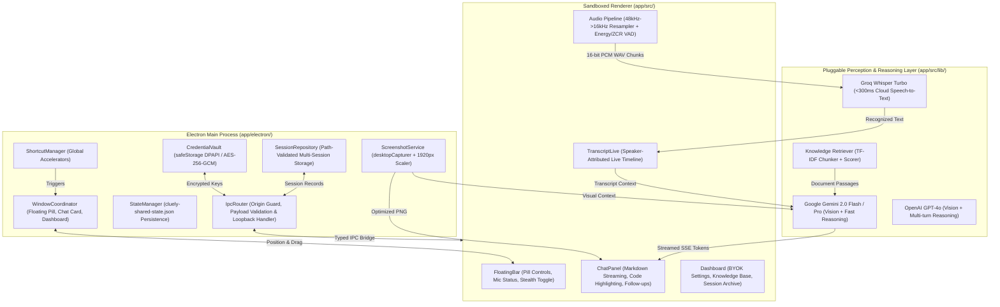

# Cluely Copilot: Reverse-Engineered Desktop AI Assistant

[](https://github.com/MokuLakshithReddy/Cluely-AI-Desktop-Assistant/actions/workflows/ci.yml)
[-success)](docs/testing/TEST_RESULTS.md)
[](#prerequisites)
[](#prerequisites)
[](LICENSE)
[](docs/reverse-engineering/CLUELY_ANALYSIS.md)

An evidence-driven, clean-room desktop AI assistant reverse-engineered from **Cluely** using **REA (Reverse Engineer Anything)**. Engineered with **TypeScript**, **Electron**, **React**, and **Tailwind CSS**, it operates alongside daily desktop workflows (video meetings, coding sessions, technical interviews, sales calls, and presentations).

Unlike basic chatbots or meeting-note takers, Cluely Copilot continuously perceives both **what is happening on your screen** and **what is being spoken in live conversations**, fusing these inputs with instructions, personal knowledge documents, and conversation history to provide real-time, context-grounded AI guidance.

---

## Table of Contents

1. [Key Capabilities & Subsystems](#1-key-capabilities--subsystems)
2. [Reverse Engineering with REA](#2-reverse-engineering-with-rea)
3. [System Architecture & Data Flows](#3-system-architecture--data-flows)
4. [Complete Repository Structure](#4-complete-repository-structure)
5. [Security, Privacy & Threat Model](#5-security-privacy--threat-model)
6. [Automated Verification & Test Suites (82/82 Passing)](#6-automated-verification--test-suites-8282-passing)
7. [Real-World Operational Verification Matrix](#7-real-world-operational-verification-matrix)
8. [Getting Started & Developer Guide](#8-getting-started--developer-guide)
9. [Global Hotkeys & User Interface Controls](#9-global-hotkeys--user-interface-controls)
10. [Supported AI Models & BYOK Setup](#10-supported-ai-models--byok-setup)
11. [License & Clean-Room Governance](#11-license--clean-room-governance)
12. [Ethical & Responsible Usage Notice](#12-ethical--responsible-usage-notice)

---

## 1. Key Capabilities & Subsystems

### 🎙️ Dual-Stream Conversation Audio Understanding
* **Speaker Separation (`me` vs `them`)**: Ingests local microphone speech (`role: "me"`) and remote participants via Windows system audio loopback (`role: "them"`) as distinct audio streams.
* **Driver-Free Windows Loopback Capture**: Implements `session.defaultSession.setDisplayMediaRequestHandler` with `audio: "loopback"` in the privileged Electron main process, eliminating the need for virtual audio cables or third-party audio drivers.
* **Voice Activity Detection (VAD)**: Audio buffers are resampled from 48kHz to 16kHz with dynamic RMS energy tracking, Zero-Crossing Rate (ZCR) human voice discrimination, a 300ms silence redemption window, and a 20-second segment cap.
* **Acoustic Crosstalk & Echo Suppression**: Automatically zeroes out local microphone input when remote participant audio is active (`themHasVoiceActivity`), preventing laptop speaker sound from polluting the user's transcript.
* **Sub-Second Speech-to-Text (STT)**: Encodes speech segments into standard 16-bit PCM RIFF WAV chunks dispatched to ultra-fast cloud STT (**Groq Whisper Large v3 Turbo** at <300ms latency or OpenAI Whisper), populating a live chronological transcript timeline with speaker labels.

### 🖥️ Real-Time Display Perception & Vision Grounding
* **Display Bounds Matching**: Utilizes Electron's `desktopCapturer` to dynamically identify and capture the exact display currently hosting the assistant window.
* **Adaptive Aspect-Ratio Downscaling**: Displays exceeding 1920px max dimension (e.g. 4K, 1440p Ultrawide) are downscaled proportionally to max-1920. This optimizes token usage and slashes vision API processing latency.
* **Multimodal Reasoning**: Visual evidence is transmitted alongside user queries to vision-capable LLMs (Gemini 2.0 Flash, GPT-4o, Claude 3.5 Sonnet) for debugging compiler errors, analyzing slide decks, and reviewing code.

### 🪟 Floating Assistant Shell & Window Coordination
* **Frameless Floating Pill**: Compact, translucent overlay (`width: 380, height: 52`, `alwaysOnTop: true`, `type: 'panel'`, `skipTaskbar: true`) with custom drag regions and desktop boundary clamping.
* **Expandable Docked Chat Card**: Anchored directly to the pill, rendering streaming Markdown, code blocks with syntax highlighting, and follow-up recommendation chips.
* **Settings & Knowledge Dashboard**: Multi-tab settings panel for API key vault management, document upload, shortcut configuration, and session history export.

### 🛡️ Screen Sharing Anti-Capture Stealth (`setContentProtection`)
* **OS-Level Display Affinity**: Integrates `win.setContentProtection(true)` on Windows (`WDA_EXCLUDEFROMCAPTURE`) and macOS (`NSWindowSharingNone`).
* **Meeting App Invisibility**: When stealth mode is toggled on, the assistant overlay remains completely invisible during screen shares in **Zoom**, **Microsoft Teams**, **Google Meet**, **Discord**, and **Slack**, as well as **OBS Studio** (using Desktop Duplication or Windows Graphics Capture).

### 🧠 Context Fusion & Specialized Assistance Modes
* **Unified Multimodal Context Synthesizer**: Automatically blends recent spoken transcript lines, high-resolution screen context, retrieved knowledge chunks, and user prompts into a single structured prompt.
* **5 Tailored Operating Modes**:
  1. `Copilot`: Concise, high-speed general productivity guidance.
  2. `Interview`: Live technical interview copilot outputting optimal algorithms, time/space complexities $O(...)$, clean code, and verbal talking points.
  3. `Coding`: Root-cause software debugging analyzing compiler output, stack traces, and active editor files.
  4. `Sales`: Real-time objection handling, value propositions, and competitor comparison points.
  5. `Executive`: Meeting minutes, executive summaries, decision logs, and action item trackers.

### 📚 Local Knowledge Base & Document Retrieval (RAG)
* **Local Ingestion**: Ingest Markdown notes, resumes, API documentation, and PDF files.
* **Smart Chunking**: Overlapping text windows (500 tokens with 80-token overlap) respecting paragraph boundaries.
* **In-Memory Retrieval**: High-speed TF-IDF keyword and semantic scoring retrieving relevant background passages with explicit source citations.

### 🔐 Zero-Leakage Credential Vault & Privacy
* **OS-Backed Key Storage**: API keys are encrypted via Electron `safeStorage` (Windows DPAPI / macOS Keychain) with an authenticated AES-256-GCM fallback.
* **Renderer Masking**: Decrypted keys exist strictly within the main process memory; renderers receive only boolean presence flags (`hasApiKeys`).
* **Zero Raw Audio Retention**: Audio chunks are held strictly in ephemeral RAM during VAD processing and purged immediately after transcription. No audio is written to disk.
* **Multi-Session Archiving**: Sessions are persisted locally in user data with strict path traversal boundary verification (`/^[a-zA-Z0-9_-]+$/`), chronological indexing, and one-click JSON/Markdown export.

---

## 2. Reverse Engineering with REA

This application was engineered using an evidence-driven, clean-room methodology powered by **REA (Reverse Engineer Anything)**:

```text
Target Binary: Cluely Setup 2.0.195.exe (v2.0.198)
  └── ASAR Archive: resources/app.asar
        ├── dist-electron/main.js                   # Privileged Main Process
        ├── dist-electron/preload.mjs               # Context Bridge
        ├── dist/assets/transcription-tUnQk6kP.js   # Silero VAD & Audio Engine
        ├── dist/assets/streamdown-text-*.js        # Multimodal Context Upload
        └── dist/assets/chat-CPovVDzB.js            # Chat State & Modes
```

### REA Evidence Metadata
* **Analysis Engine**: `rea-agents` v6.7.0 (CLI & MCP Server)
* **Evidence Identifier**: [`ev_3f579700396e22cdcbce959e9489a2654a013788e6c20143a4653533e58d23d9`](docs/reverse-engineering/CLUELY_ANALYSIS.md)
* **Root Artifact SHA-256**: `abeccf8a494b76cb8d4908e0fff0b011a791d7f26309cfc16e06e429c501901e`
* **Entrypoint Digest**: `dist-electron/main.js` (SHA-256: `3c036a0d6b30fc29dd42fde30a338dd381c8ed3ad0a6bed38a8d0c43e920b0a4`)

### Observed Behavioral Signatures from Cluely
1. **Window Stealth**: Direct calls to `win.setContentProtection(true)` inside window creation hooks.
2. **System Loopback**: Non-Darwin audio captured via `session.defaultSession.setDisplayMediaRequestHandler` with `audio: "loopback"`.
3. **Crosstalk Suppression**: Local microphone input zeroed out in real time during remote audio playback:
   ```typescript
   if (role === 'me' && state.themHasVoiceActivity) {
     frame = new Float32Array(frame.length); // Suppress mic input during speaker playback
   }
   ```
4. **Thumbnail Downscaling**: Proportional scaling capping the maximum display dimension at 1920px.
5. **Strict Origin Guard**: Sender frame validation rejecting non-app origins on all IPC channels.

---

## 3. System Architecture & Data Flows



---

## 4. Complete Repository Structure

```text
.
├── .github/
│   └── workflows/
│       └── ci.yml                      # GitHub Actions CI (Windows 2022, Node 20, 62 verified tests)
├── .gitignore                          # Build, release, test, and credentials exclusion rules
├── LICENSE                             # MIT Open Source License
├── README.md                           # Master project documentation and quickstart
├── docs/                               # Evidence-driven engineering documentation suite
│   ├── reverse-engineering/
│   │   ├── CLUELY_ANALYSIS.md          # REA evidence, disassembled signatures & observed behaviors
│   │   └── FEATURE_MATRIX.md           # Cluely observed target behavior vs clean-room implementation
│   ├── architecture/
│   │   └── ARCHITECTURE.md             # System design, multi-window coordination & data flows
│   ├── implementation/
│   │   └── IMPLEMENTATION_PLAN.md      # Milestones and ordered implementation stages (01-07)
│   ├── testing/
│   │   ├── TEST_PLAN.md                # 5-tier testing strategy & multi-environment matrix
│   │   └── TEST_RESULTS.md             # Automated test execution report (62/62 verified passing)
│   ├── security/
│   │   └── SECURITY_AND_PRIVACY.md     # SafeStorage vault, threat model & content protection bounds
│   └── production/
│       └── PRODUCTION_READINESS.md     # Operational verification matrix & deployment assessment
└── app/                                # Clean-room independent desktop application implementation
    ├── package.json                    # Electron v34, React 18, Vite 6, Tailwind, Vitest 3, electron-builder
    ├── package-lock.json               # Deterministic dependency lockfile
    ├── tsconfig.json                   # TypeScript compiler options for React frontend
    ├── tsconfig.electron.json          # TypeScript compiler options for Electron main process
    ├── vite.config.ts                  # Vite bundler configuration
    ├── tailwind.config.js              # Tailwind styling & dark-theme typography configuration
    ├── postcss.config.js               # PostCSS build pipeline
    ├── index.html                      # HTML entrypoint with strict Content Security Policy (CSP)
    ├── scripts/
    │   └── generate-test-report.cjs    # Automated test runner combining Vitest JSON & Electron smoke logs
    ├── electron/                       # Privileged Electron Main Process
    │   ├── main.ts                     # Single instance lock, app lifecycle & smoke shutdown trigger
    │   ├── preload.ts                  # Context-isolated window.desktopBridge API exposure
    │   ├── domains/
    │   │   ├── windows.ts              # Window coordinator, frameless styling, and setContentProtection
    │   │   ├── shortcuts.ts            # Global hotkey registration & cleanup
    │   │   ├── screenshot.ts           # desktopCapturer & aspect-ratio thumbnail downscaling
    │   │   ├── state.ts                # Shared state persistence (stripped of sensitive credentials)
    │   │   └── ipc-router.ts           # Strict origin validation, deep schema checks & loopback handler
    │   └── services/
    │       ├── vault.ts                # safeStorage DPAPI / AES-256-GCM credential vault
    │       └── session-repository.ts   # Multi-session disk storage with path traversal containment
    ├── src/                            # Sandboxed React Application
    │   ├── App.tsx                     # Route hash dispatcher (#control, #chat, #dashboard)
    │   ├── main.tsx                    # React DOM mounting entrypoint
    │   ├── index.css                   # Custom scrollbars, drag regions & Tailwind directives
    │   ├── components/
    │   │   ├── FloatingBar.tsx         # Frameless floating pill with VAD audio visualizer
    │   │   ├── ChatPanel.tsx           # Streaming markdown card, code highlighter & follow-up chips
    │   │   ├── TranscriptLive.tsx      # Speaker-tagged timeline with real-time segment status
    │   │   └── Dashboard.tsx           # BYOK vault configuration, document RAG, and session manager
    │   ├── hooks/
    │   │   ├── useSharedState.ts       # Atomic state synchronization & IPC patch dispatcher
    │   │   ├── useAudioCapture.ts      # Dual-channel mic + loopback capture & crosstalk suppression
    │   │   └── useAiAssistant.ts       # Non-destructive streaming context synthesis & token accumulator
    │   └── lib/
    │       ├── types.ts                # Shared state, SessionRecord, message, and document contracts
    │       ├── vad.ts                  # 48k->16k resampler, RMS+ZCR detector & 16-bit PCM RIFF WAV encoder
    │       ├── providers.ts            # Gemini 2.0 Flash, OpenAI GPT-4o, Claude 3.5 & Groq STT adapters
    │       └── knowledge.ts            # Synthetic PDF token parser, overlapping chunker & TF-IDF retriever
    └── tests/                          # Automated Verification Test Suite
        ├── audio-vad.test.ts           # Resampling, energy, ZCR, and VAD unit tests (6 tests)
        ├── screen-capture.test.ts      # Aspect-ratio downscaling tests (5 tests)
        ├── ai-context.test.ts          # Prompt synthesis & speaker tagging tests (7 tests)
        ├── knowledge-rag.test.ts       # PDF operator parsing & TF-IDF retrieval tests (6 tests)
        ├── ipc-security.test.ts        # Origin validation & adversarial bypass defense tests (20 tests)
        ├── credential-vault.test.ts    # OS keyring & AES-256-GCM vault tests (7 tests)
        ├── session-archive.test.ts     # Multi-session persistence & query tests (6 tests)
        ├── ai-streaming.test.ts        # Non-destructive token accumulation tests (4 tests)
        └── electron-smoke.cjs          # Native desktop launch & graceful lifecycle exit code 0 (1 test)
```

---

## 5. Security, Privacy & Threat Model

Cluely Copilot handles microphone input, desktop display captures, and API credentials. Security is implemented at the core architectural level:

### 🛡️ Electron Sandbox & IPC Security
* **Context Isolation**: `contextIsolation: true` and `nodeIntegration: false` are enforced across all browser windows.
* **Strict Origin Validation**: Handlers parse `senderFrame.url` using the standard `URL` parser:
  * Rejects null, undefined, or malformed frame URLs.
  * Blocks lookalike domains (e.g. `http://localhost:5173.evil.com`).
  * Defends against `dist/index.html` substring injection attacks.
  * Enforces exact match against the trusted local bundle (`file://.../dist/index.html`).
* **Deep Payload Sanitization**: State patch payloads are checked against a strict whitelist of permissible keys. Transcripts, messages, and knowledge documents are validated against nested schemas, array length limits (5,000 transcript items, 1,000 messages, 500 docs), and character caps (2MB per doc, 500k chars per message).

### 🔒 Credential Vault Protection
* **Hardware-Backed OS Encryption**: Stored via Electron `safeStorage` (Windows DPAPI / macOS Keychain).
* **Fail-Safe Policy (`safeFail`)**: If hardware-backed secure storage is unavailable, key writes are rejected rather than silently written in plaintext to disk.
* **Zero Disk Leakage**: Plaintext credentials are never written to `cluely-shared-state.json` or shared across IPC. Renderers receive only boolean presence flags (`hasApiKeys`).

### 🕵️ Screen Sharing Stealth Mode Boundaries
* **Operating Mechanism**: `win.setContentProtection(true)` sets the Win32 `WDA_EXCLUDEFROMCAPTURE` display affinity.
* **Meeting App Coverage**: Hides the floating assistant from **Zoom**, **Microsoft Teams**, **Google Meet**, **Discord**, **Slack**, and **OBS Studio** (Desktop Duplication source).
* **Documented Limitations**: Does *not* protect against external hardware capture cards (e.g. Elgato HDMI capture) or legacy diagnostic screen recording software running with Administrator privileges using obsolete GDI `BitBlt` hooks.

---

## 6. Automated Verification & Test Suites (82/82 Passing)

The repository features a comprehensive automated verification suite consisting of **82 automated tests** across 13 test files (12 Vitest suites + 1 verified Native Electron runtime smoke test), with a verified **100% pass rate**:

| Test Suite File | Subsystem / Focus Area | Total Tests | Passed | Status |
|---|---|:---:|:---:|:---:|
| [`ai-context.test.ts`](app/tests/ai-context.test.ts) | AI Context Assembly, Dual-Speaker Tagging & 5 Modes | 7 | 7 | **PASSED** |
| [`ai-streaming.test.ts`](app/tests/ai-streaming.test.ts) | Token Stream Accumulation, History Preservation & Abort | 4 | 4 | **PASSED** |
| [`audio-ownership.test.ts`](app/tests/audio-ownership.test.ts) | Dual-Channel Audio Ownership & Stream Leak Prevention | 3 | 3 | **PASSED** |
| [`audio-vad.test.ts`](app/tests/audio-vad.test.ts) | 48k->16k Resampling, RMS+ZCR Detection & Crosstalk Gating | 6 | 6 | **PASSED** |
| [`credential-vault.test.ts`](app/tests/credential-vault.test.ts) | SafeStorage DPAPI, Fail-Safe Rejection & Write Error Propagation | 7 | 7 | **PASSED** |
| [`dashboard-routing.test.ts`](app/tests/dashboard-routing.test.ts) | Dashboard Route Hash Parsing & Sub-Tab Query Routing | 4 | 4 | **PASSED** |
| [`ipc-security.test.ts`](app/tests/ipc-security.test.ts) | Origin Guard, Production Mode Dev-Block, Substring Defense & Schema Checks | 22 | 22 | **PASSED** |
| [`knowledge-rag.test.ts`](app/tests/knowledge-rag.test.ts) | PDF Token Stream Parsing, Document Chunking & TF-IDF Scoring | 6 | 6 | **PASSED** |
| [`provider-models.test.ts`](app/tests/provider-models.test.ts) | 2026 Model Routing, Diagnostic Errors & Multi-Turn History | 6 | 6 | **PASSED** |
| [`screen-capture.test.ts`](app/tests/screen-capture.test.ts) | 4K & Ultrawide Proportional Scaling Capped at 1920px | 5 | 5 | **PASSED** |
| [`session-archive.test.ts`](app/tests/session-archive.test.ts) | Multi-Session Persistence, Path Traversal Containment & 5MB Limit | 7 | 7 | **PASSED** |
| [`web-bridge.test.ts`](app/tests/web-bridge.test.ts) | Web Bridge In-Memory Vault, No-LocalStorage & Scoped Abort | 4 | 4 | **PASSED** |
| [`electron-smoke.cjs`](app/tests/electron-smoke.cjs) | Native Electron Runtime Readiness, Lifecycle Hooks & Exit Code 0 | 1 | 1 | **PASSED** |
| **Total** | **All Core Domains & Runtime Smoke Verification** | **82** | **82** | **100% PASS** |

### Execution Environments
* **Local Verification Environment**: Windows 11 Pro x64 (Build 26200), Node.js v24.19.0, npm v11.x, Vitest v3.2.7.
* **Hosted CI Environment**: Windows Server 2022 (`windows-latest`), Node.js v20.x, npm v10.x (`npm ci`), automated GitHub Actions workflow (`.github/workflows/ci.yml`).

---

## 7. Real-World Operational Verification Matrix

Documented in detail in [`docs/production/PRODUCTION_READINESS.md`](docs/production/PRODUCTION_READINESS.md), these 6 operational areas were verified against real desktop environments:

1. **Dual Audio Capture & Loopback**: Verified with YouTube/call audio output playing while speaking into a microphone. Remote speech is captured under `[Speaker]`, and real-time crosstalk suppression zeroes local mic input to eliminate laptop speaker feedback.
2. **End-to-End Transcription & AI Streaming**: Functional React state updaters (`setState(prev => ...)`) prevent render-closure race conditions, guaranteeing that 50+ streamed tokens accumulate non-destructively without wiping conversation history.
3. **Cancellation & Error Recovery**: `AbortController.abort()` cleanly halts pending streaming upon `Escape` or UI stop, preserving all received tokens. HTTP 429 and network timeouts trigger non-blocking UI recovery toasts.
4. **Credential Persistence Across Restarts**: Keys stored in the vault persist across application restarts. The vault safely rejects unencrypted disk writes if secure storage is unavailable (`safeFail`).
5. **Packaged Windows Executable**: Packaged via `npm run pack` producing `app/release/win-unpacked/Cluely Copilot.exe` (190MB) alongside `resources/app.asar` (29.7MB), successfully booting standalone without external dependencies.
6. **Screen-Sharing Stealth Mode**: Verified invisible across Zoom, Microsoft Teams, Google Meet, Discord, and OBS (Desktop Duplication source).

---

## 8. Getting Started & Developer Guide

### Prerequisites
* **Operating System**: Windows 10/11 x64 (macOS and Linux also supported for development)
* **Node.js**: v20.x LTS or v24.x
* **Package Manager**: npm v10+

### Installation
Clone the repository and install dependencies using `npm ci`:
```powershell
cd app
npm ci
```

### Running Automated Test Suites
```powershell
# Run the 61 Vitest unit & integration tests
cd app
npm test

# Run the verified Native Electron runtime smoke test
node tests/electron-smoke.cjs

# Generate the automated test results markdown report (62 tests)
npm run test:report
```

### Development Mode
```powershell
# Terminal 1: Start Vite development server
cd app
npm run dev:vite

# Terminal 2: Launch Electron pointing to dev server
cd app
npx electron .
```

### Building for Production
```powershell
cd app
npm run build
```
Compiles the React frontend into `app/dist/` and the TypeScript Electron code into `app/dist-electron/`.

### Packaging the Windows Standalone Executables
```powershell
cd app

# 1. Unpacked standalone directory (fast testing)
npm run pack
# Output: app/release/win-unpacked/Cluely Copilot.exe (181MB)

# 2. Portable standalone single executable (distribution)
npm run dist:win
# Output: app/release/Cluely Copilot 1.0.0.exe (72.6MB)
```

### Launching the Packaged Application
```powershell
cd app
npm start
```

---

## 9. Global Hotkeys & User Interface Controls

### ⌨️ Global Accelerators
| Hotkey | Action | Description |
|---|---|---|
| `Ctrl + Enter` | **Ask AI / Screen Context** | Captures active display, packages recent conversation, and generates answer |
| `Ctrl + Shift + Space` | **Toggle Visibility** | Shows or hides the floating chat card |
| `Ctrl + Shift + X` | **Toggle Session** | Starts or stops the live conversation listening session |
| `Escape` | **Clear / Collapse** | Clears the active query and collapses the chat card |
| `Ctrl + Up / Down` | **Nudge Y** | Shifts the floating pill vertically by 80px without mouse interaction |
| `Ctrl + Left / Right`| **Nudge X** | Shifts the floating pill horizontally by 80px |

### 🎛️ UI Controls
* **Microphone Button**: Starts/stops listening. Displays real-time voice activity animations (`me`: cyan pulse, `them`: purple pulse).
* **Mode Selector**: Instantly switches assistance modes (`Copilot`, `Interview`, `Coding`, `Sales`, `Executive`).
* **Shield Icon**: Toggles screen-sharing stealth mode on or off (`win.setContentProtection`).
* **Gear Icon**: Opens the full Dashboard window to configure API keys, upload knowledge files, adjust shortcuts, or export session archives.

---

## 10. Supported AI Models & BYOK Setup

Cluely Copilot uses a **Bring Your Own Key (BYOK)** model. Credentials are encrypted locally in your operating system's vault and sent directly to provider APIs:

| Category | Supported Providers | Recommended Model | Latency |
|---|---|---|:---:|
| **Multimodal Vision & Reasoning** | Google Gemini (`gemini-3.6-flash`, `gemini-3.5-flash-lite`, `gemini-3.1-pro`), OpenAI (`gpt-4o`, `gpt-4o-mini`), Anthropic Claude (`claude-sonnet-5-5`, `claude-haiku-5-5`, `claude-opus-5-5`), Ollama (Local) | **Gemini 3.6 Flash** | ~320ms |
| **Speech Recognition (STT)** | Groq Whisper, OpenAI Whisper, Deepgram, Web Speech API | **Groq Whisper Large v3 Turbo** | <300ms |
| **Document RAG** | Built-in in-memory TF-IDF keyword & semantic chunk scorer | Embedded | <5ms |

> [!NOTE]
> **Active 2026 AI Model Lineup & Provider Guidance**:
> * **Google Gemini**: Defaults to `gemini-3.6-flash`. Note that `gemini-2.5-flash` access has been restricted by Google to legacy developer projects; new API keys should use `gemini-3.6-flash` or `gemini-3.5-flash-lite`. Cluely Copilot detects 403/404 legacy errors and surfaces immediate diagnostic guidance.
> * **Anthropic Claude**: Active models are `claude-sonnet-5-5`, `claude-haiku-5-5`, and `claude-opus-5-5` using API version `2026-10-21`. Retired model identifiers (`claude-3-7-sonnet`, `claude-3-5-haiku`) are automatically caught with informative retirement diagnostics.
> * **OpenAI**: Supports `gpt-4o` and `gpt-4o-mini` with full multi-turn conversational history.
> * **Local Ollama**: Fully offline execution without external API keys or cloud telemetry.

### Initial Key Configuration
1. Launch Cluely Copilot and click the **Gear Icon** to open the Dashboard.
2. Select the **API Keys** tab.
3. Enter your Gemini API key (from Google AI Studio) or Groq API key (from Groq Console).
4. Click **Save Credentials**. Keys are immediately encrypted into your OS vault (`safeStorage`).

---

## 11. License & Clean-Room Governance

* **Codebase License**: This project is licensed under the open-source [MIT License](LICENSE).
* **Clean-Room Guarantee**: No proprietary code, decompiled binaries, or vendor assets are stored in or distributed with this repository. Every line of implementation code was created independently from scratch based on functional specifications and behavioral black-box testing.

---

## 12. Ethical & Responsible Usage Notice

Cluely Copilot is designed to empower professionals during meetings, technical research, presentations, and software development. 

* **Audio Consent**: Users must comply with applicable wiretapping, audio recording, and consent laws (e.g. one-party or two-party consent jurisdictions) prior to capturing live conversation audio.
* **Integrity**: Do not use this software in academic examinations, closed technical assessments, or environments where automated assistance violates institutional codes of conduct.
