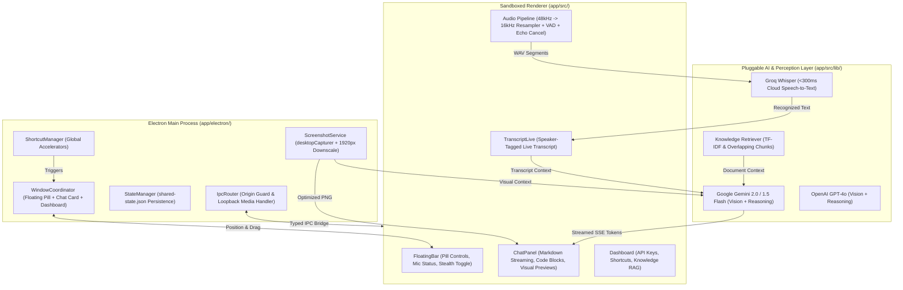

# Cluely Copilot: Reverse-Engineered Desktop AI Assistant

An evidence-driven, clean-room desktop AI assistant reverse-engineered from **Cluely** using **REA (Reverse Engineer Anything)**. Built with **TypeScript**, **Electron**, **React**, and **Tailwind CSS**, it operates alongside everyday desktop workflows (video meetings, coding sessions, technical interviews, sales calls, and presentations).

Unlike basic chatbots or note-taking apps, this application continuously interprets both what is **happening on your screen** and what is **being spoken in live conversation**, fusing these signals with user prompts and personal knowledge to provide real-time, context-grounded AI guidance.

---

## 1. Key Capabilities

* **Live Screen Understanding**:
  * Real-time display capture via Electron `desktopCapturer`.
  * Multi-display awareness: automatically matches and captures the screen containing the active assistant window.
  * Adaptive aspect-ratio downscaling: displays exceeding 1920px max dimension are scaled down proportionally to ensure minimal multimodal latency and optimal token consumption.
  * Vision AI interpretation for code editors, compiler errors, presentation slides, meeting screens, and documentation.

* **Dual-Stream Conversation Audio Understanding**:
  * **Dual-Channel Speaker Separation**: Local microphone (`me`) and remote participants via Windows system audio loopback (`them`) are ingested as independent streams.
  * **Native Loopback Capture**: Implements `session.defaultSession.setDisplayMediaRequestHandler` with `audio: "loopback"` on Windows, eliminating the need for virtual audio cable drivers.
  * **Voice Activity Detection (VAD)**: Powered by 16kHz resampling and an energy/Silero VAD state machine featuring a 300ms silence redemption window and a 20-second maximum speech segment cap.
  * **Crosstalk & Speaker Echo Suppression**: Automatically zeroes out local microphone input when remote participant audio is active, eliminating acoustic feedback from laptop speakers.
  * **Real-Time Speech-to-Text**: Encodes speech into 16-bit PCM WAV chunks and streams them through ultra-fast cloud STT (Groq Whisper at <300ms latency, OpenAI Whisper) to populate a live transcript timeline with speaker labels and timestamps.

* **Floating Assistant Overlay**:
  * Frameless, transparent floating pill (`width: 380, height: 52`, `alwaysOnTop: true`, `type: 'panel'`, `skipTaskbar: true`).
  * Custom drag regions with snap-to-edge desktop bounds clamping.
  * Expandable docked chat card displaying streaming markdown, code syntax blocks, and follow-up chips.

* **Screen Sharing Stealth Mode (`setContentProtection`)**:
  * Integrates `win.setContentProtection(true)` to enforce OS-level display affinity (`WDA_EXCLUDEFROMCAPTURE` on Windows, `NSWindowSharingNone` on macOS).
  * When enabled, meeting software such as **Zoom**, **Microsoft Teams**, **Google Meet**, and **Slack** cannot capture the assistant window—it remains completely invisible to other call participants.

* **Context Fusion & Grounded Reasoning**:
  * Unified prompt synthesizer combining recent spoken transcript lines, high-resolution visual context, user queries, and retrieved knowledge passages.
  * Multiple specialized assistance modes:
    * `Copilot`: Concise general desktop assistant.
    * `Interview`: Technical interview copilot delivering optimal algorithms, time/space complexities $O(...)$, clean code, and talking points.
    * `Coding`: Software engineer debugger identifying root causes from stack traces and compiler errors.
    * `Sales`: Live objection handling and value proposition prompts.
    * `Executive`: Meeting minutes, decisions, and action items.

* **Local Knowledge Base & Retrieval (RAG)**:
  * Import custom Markdown notes, resumes, API documentation, and code snippets.
  * Overlapping text chunking (500 tokens with 80-token overlap).
  * Local TF-IDF keyword & semantic cosine retrieval with source attribution.

* **Privacy & Bring-Your-Own-Key (BYOK)**:
  * Zero raw audio retention: audio buffers exist only in ephemeral memory and are discarded after transcription.
  * Explicit capture indicators on the floating pill.
  * OS-backed credential vault (`safeStorage` utilizing Windows DPAPI / macOS Keychain, with AES-256-GCM fallback). Decrypted keys are strictly isolated in the main process and never broadcast to renderers or serialized to disk in plaintext.
  * Multi-session history repository stored locally in user data with full search, deletion, and export capabilities.

---

## 2. Reverse Engineering with REA

This project was built following an evidence-driven reverse engineering methodology:

```text
Target Binary (Cluely Setup 2.0.195.exe, v2.0.198)
  └── ASAR Bundle (resources/app.asar)
        ├── dist-electron/main.js (Main Process)
        ├── dist-electron/preload.mjs (Preload Bridge)
        ├── dist/assets/transcription-*.js (VAD & Audio Engine)
        └── dist/assets/streamdown-*.js (Multimodal Context Upload)
```

### REA Evidence Details
* **REA Tooling**: `rea-agents` v6.7.0 (CLI & MCP server)
* **Evidence Identifier**: `ev_3f579700396e22cdcbce959e9489a2654a013788e6c20143a4653533e58d23d9`
* **Root Artifact SHA-256**: `abeccf8a494b76cb8d4908e0fff0b011a791d7f26309cfc16e06e429c501901e`
* **Analyzed Entrypoint**: `dist-electron/main.js` (SHA-256: `3c036a0d6b30fc29dd42fde30a338dd381c8ed3ad0a6bed38a8d0c43e920b0a4`)

### Observable Behaviors Verified from Cluely
1. **Window Protection**: Direct call to `win.setContentProtection(ue(e))` inside window initialization.
2. **Audio Architecture**: Microphone ingested via `node-record-lpcm16` / `sox.exe` (`role: "me"`), system loopback via `setDisplayMediaRequestHandler` with `audio: "loopback"` (`role: "them"`).
3. **Echo Suppression**: In `transcription-*.js`:
   ```javascript
   if (role === 'me' && state.themHasVoiceActivity) {
     frame = new Float32Array(frame.length); // Suppress local mic during remote speech
   }
   ```
4. **Thumbnail Scaling**: In `screenshot.ts`:
   ```javascript
   function calculateThumbnailSize(bounds) {
     let maxDim = Math.max(bounds.width, bounds.height);
     if (maxDim <= 1920) return bounds;
     let ratio = 1920 / maxDim;
     return { width: Math.round(bounds.width * ratio), height: Math.round(bounds.height * ratio) };
   }
   ```
5. **IPC Origin Verification**: Strict validation of `event.senderFrame.url` to prevent origin spoofing or untrusted iframe injection.

---

## 3. System Architecture



---

## 4. Repository Structure

```text
.
├── docs/                               # Project documentation suite
│   ├── reverse-engineering/
│   │   ├── CLUELY_ANALYSIS.md          # Comprehensive evidence & reverse-engineered findings
│   │   └── FEATURE_MATRIX.md           # Target behavior vs. independent implementation
│   ├── architecture/
│   │   └── ARCHITECTURE.md             # System design, boundaries & data flows
│   ├── implementation/
│   │   └── IMPLEMENTATION_PLAN.md      # Milestones and ordered stages (01-07)
│   ├── testing/
│   │   ├── TEST_PLAN.md                # 5-tier testing strategy
│   │   └── TEST_RESULTS.md             # Verified test runs & smoke results (62 tests)
│   ├── security/
│   │   └── SECURITY_AND_PRIVACY.md     # Permissions, stealth & safeStorage vault
│   └── production/
│       └── PRODUCTION_READINESS.md     # Release blockers & acceptance verification
├── .github/
│   └── workflows/
│       └── ci.yml                      # GitHub Actions CI workflow (Windows build, tests & smoke)
├── app/                                # Clean-room independent desktop implementation
│   ├── package.json                    # Electron, React, Tailwind, Vite, Vitest
│   ├── tsconfig.json                   # TypeScript config for frontend
│   ├── tsconfig.electron.json          # TypeScript config for Electron main
│   ├── vite.config.ts                  # Vite build bundler
│   ├── tailwind.config.js              # Styling & theme configuration
│   ├── index.html                      # App root with strict CSP policy
│   ├── electron/
│   │   ├── main.ts                     # Single instance lock & app lifecycle
│   │   ├── preload.ts                  # Context-isolated desktopBridge (vault, sessions, AI stream)
│   │   ├── domains/
│   │   │   ├── windows.ts              # Multi-window coordinator & stealth (WDA_EXCLUDEFROMCAPTURE)
│   │   │   ├── shortcuts.ts            # Global hotkey manager
│   │   │   ├── screenshot.ts           # Screen capture & 1920px thumbnail scaler
│   │   │   ├── state.ts                # Shared state persistence (stripped of secrets)
│   │   │   └── ipc-router.ts           # Strict origin-verified IPC & display loopback handler
│   │   └── services/
│   │       ├── vault.ts                # OS-backed safeStorage / AES-256-GCM credential vault
│   │       └── session-repository.ts   # Multi-session disk persistence & archiving
│   ├── src/
│   │   ├── App.tsx                     # Route dispatcher (#control, #chat, #dashboard)
│   │   ├── components/
│   │   │   ├── FloatingBar.tsx         # Frameless floating pill UI
│   │   │   ├── ChatPanel.tsx           # AI response card with markdown streaming
│   │   │   ├── TranscriptLive.tsx      # Real-time transcript with speaker badges
│   │   │   └── Dashboard.tsx           # Vault credentials, models, document RAG & session archive
│   │   ├── hooks/
│   │   │   ├── useSharedState.ts       # Functional patchState & atomic state synchronization
│   │   │   ├── useAudioCapture.ts      # Dual-stream loopback + mic capture & VAD dispatch
│   │   │   └── useAiAssistant.ts       # Non-destructive streaming context synthesis
│   │   └── lib/
│   │       ├── types.ts                # Shared state, SessionRecord, and message contracts
│   │       ├── vad.ts                  # Resampler (48k->16k), RMS+ZCR voice detector, RIFF WAV
│   │       ├── providers.ts            # Gemini, OpenAI, Claude 3.5, Ollama & Groq STT adapters
│   │       └── knowledge.ts            # PDF parser, multi-file chunker & TF-IDF retriever
│   └── tests/
│       ├── audio-vad.test.ts           # Resampling, energy, ZCR, and VAD unit tests (6 tests)
│       ├── screen-capture.test.ts      # Aspect-ratio downscaling tests (5 tests)
│       ├── ai-context.test.ts          # Prompt synthesis & speaker tagging tests (7 tests)
│       ├── knowledge-rag.test.ts       # PDF operator parsing & TF-IDF retrieval tests (6 tests)
│       ├── ipc-security.test.ts        # Origin validation & adversarial bypass defense tests (20 tests)
│       ├── credential-vault.test.ts    # OS keyring & AES-256-GCM vault tests (7 tests)
│       ├── session-archive.test.ts     # Multi-session persistence & query tests (6 tests)
│       ├── ai-streaming.test.ts        # Non-destructive token accumulation tests (4 tests)
│       └── electron-smoke.cjs          # Native desktop launch & lifecycle smoke test (1 test)
├── LICENSE                             # MIT License
└── README.md                           # Documentation & quickstart guide
```

---

## 5. Getting Started

### Prerequisites
* **Node.js**: v20+ or v24+
* **Operating System**: Windows 10/11 (or macOS / Linux)

### Installation
Clone the repository and install dependencies:
```powershell
cd app
npm install
```

### Running Automated Tests
```powershell
cd app
npm test
```
Runs the 61-test Vitest suite across 8 core subsystems:
* 48kHz to 16kHz resampling, RMS energy, and Zero-Crossing Rate (ZCR) human voice detection
* Voice Activity Detection state transitions, silence redemption, and crosstalk suppression
* 16-bit PCM RIFF WAV binary encoding
* Aspect-ratio thumbnail downscaling (1080p, 4K, Ultrawide, Portrait)
* Dual-speaker transcript formatting (`[You]` and `[Speaker]`) and 5 operating mode guidance
* PDF token stream parsing, document chunking, and TF-IDF search relevance
* Strict IPC sender frame origin verification, lookalike hostname blocking, `dist/index.html` substring bypass defense
* Per-field schema validation on state patches (booleans, enum modes, shortcuts, structured sessions, knowledgeDocs)
* OS-backed credential vault encryption, safe failure when keyring is missing, and write error propagation
* Path traversal boundary protection and strict session ID validation in session storage
* Multi-session chronological indexing, retrieval, and purging
* AI response token accumulation without message history loss

### Executing Native Desktop Smoke Test
```powershell
cd app
node tests/electron-smoke.cjs
```
Launches the compiled Electron binary, listens for explicit `[APP_READY]` coordinator readiness signal, asserts clean IPC initialization, delivers a graceful shutdown trigger, verifies execution of `before-quit` and `will-quit` lifecycle hooks, and asserts clean termination with exit code 0 and null OS signal.

### Generating Verified Test Report
```powershell
cd app
npm run test:report
```
Executes Vitest across all 8 test suites (61 tests) in JSON reporter mode, executes the verified Electron runtime smoke test (1 test), and programmatically compiles all 62 passing test results directly into `docs/testing/TEST_RESULTS.md`.

### Packaging the Desktop Application
```powershell
cd app
npm run pack
```
Packages the complete native Windows standalone application via `electron-builder` into `app/release/win-unpacked/`, producing the compiled `Cluely Copilot.exe` executable along with unpacked dependencies and ASAR integrity archives.

### Building the Project
```powershell
cd app
npm run build
```
Builds the Vite frontend into `app/dist/` and compiles the TypeScript Electron code into `app/dist-electron/`.

### Launching the Desktop Application
```powershell
cd app
npm start
```
The application will launch with the floating pill placed at the top center of your primary display.

---

## 6. Usage & Global Hotkeys

| Hotkey | Action | Description |
|---|---|---|
| `Ctrl + Enter` | **Ask AI / Screen Context** | Captures active display, packages recent conversation, and generates answer |
| `Ctrl + Shift + Space` | **Toggle Visibility** | Shows or hides the floating chat card |
| `Ctrl + Shift + X` | **Toggle Session** | Starts or stops the live conversation listening session |
| `Escape` | **Clear / Collapse** | Clears the active query and collapses the chat card |
| `Ctrl + Up / Down` | **Nudge Y** | Shifts the floating pill vertically by 80px without mouse interaction |
| `Ctrl + Left / Right`| **Nudge X** | Shifts the floating pill horizontally by 80px |

### UI Controls
* **Microphone Pill**: Click to start/stop listening. The pulsing indicator reflects real-time voice activity.
* **Mode Dropdown**: Select between *Copilot*, *Interview*, *Coding*, *Sales*, and *Executive*.
* **Shield Icon**: Toggle screen-sharing stealth mode (uses `setContentProtection`).
* **Gear Icon**: Opens the full Dashboard window to configure API keys (Gemini, OpenAI, Groq), add knowledge documents, or export session transcripts.

---

## 7. Supported AI Models

| Capability | Supported Providers | Recommended Default |
|---|---|---|
| **Multimodal Vision & Reasoning** | Google Gemini 2.0 Flash, OpenAI GPT-4o, Anthropic Claude 3.5 Sonnet, Local Ollama | **Google Gemini 2.0 Flash** |
| **Speech Recognition (STT)** | Groq Whisper Large v3 Turbo, OpenAI Whisper, Deepgram Nova-2, Web Speech API | **Groq Whisper** (<300ms latency) |
| **Local Knowledge RAG** | In-memory TF-IDF / Term Frequency chunk search | Built-in |

---

## 8. License

This project is open-source software licensed under the [MIT License](LICENSE).

---

## 9. Ethical & Responsible Usage Notice

This software is designed as a productivity copilot for meetings, presentations, learning, and software debugging. When using real-time audio capture, ensure you comply with applicable local recording consent laws and wiretapping regulations. Do not use this tool in academic examinations, technical interviews, or environments where automated assistance violates institutional policies or codes of conduct.
