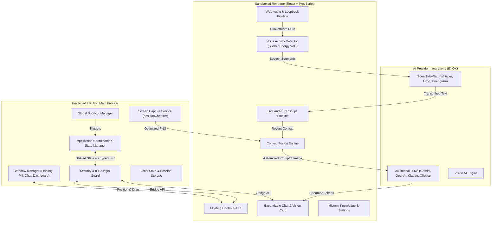
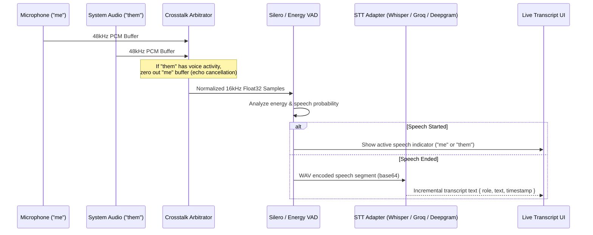

# System Architecture & Design Specification

## 1. Architectural Philosophy

The application is an independent, clean-room implementation of a desktop AI assistant inspired by Cluely. The architecture strictly separates:
1. **Privileged Native Desktop Operations** (Electron Main Process)
2. **User Interface & Interaction** (Electron Renderer Process)
3. **Audio Capture & VAD Processing** (Web Audio Worklets & Background Workers)
4. **Perception Services** (Screen capture, audio streaming, vision)
5. **AI Reasoning & Context Synthesis** (Pluggable LLM, STT, and Vision adapters)



---

## 2. Component Boundaries & Responsibilities

| Component | Layer | Responsibilities | Boundary Guarantees |
|---|---|---|---|
| **App Coordinator** | Electron Main | Manages lifecycle, coordinates window positions, handles system events, persists configuration | Sole authority over file system writes, native menus, and shortcuts |
| **Window Manager** | Electron Main | Creates and manages `ControlWindow`, `ChatWindow`, and `DashboardWindow`. Controls `alwaysOnTop`, transparency, and `setContentProtection` | Renderer cannot spawn arbitrary windows or access raw OS window handles |
| **Screen Capture Service** | Electron Main | Captures displays using `desktopCapturer.getSources`, identifies active screen, downscales to 1920px max dimension, encodes to PNG | Returns compressed image buffers only when permitted by active session |
| **IPC Origin Guard** | Electron Main | Validates `event.senderFrame.url` against application origin before dispatching to any handler | Rejects any unrecognized sender, preventing malicious injection |
| **Audio Pipeline** | Renderer / Web Audio | Ingests microphone stream and Windows loopback audio; performs 16kHz resampling | Processes raw PCM in ephemeral buffers; never writes raw audio to disk |
| **VAD Engine** | Renderer / WASM | Runs Voice Activity Detection with 300ms redemption; identifies speech start/end | Prevents continuous transmission of silence; isolates speech utterances |
| **Crosstalk Arbitrator** | Renderer | Monitors system audio (`them`) activity; zeroes microphone (`me`) input while system audio is active | Prevents acoustic echo and duplicate transcription of remote speakers |
| **Context Fusion Engine**| Renderer / AI Layer | Gathers recent transcripts, current screenshot, user instruction, and retrieved knowledge | Limits prompt token budgets; verifies sources before dispatching |
| **AI Provider Interface**| Extensible Adapter | Standardizes streaming chat completions, speech-to-text, and vision requests | Fully decoupled from UI; allows switching between Gemini, OpenAI, Claude, Groq |

---

## 3. Window Lifecycle & Coordinate Synchronization

### 3.1 Floating Pill Window (`ControlWindow`)
- **Properties**: `width: 380`, `height: 52`, `frame: false`, `transparent: true`, `alwaysOnTop: true`, `skipTaskbar: true`, `resizable: false`.
- **Drag Handling**: Native dragging or renderer mouse-drag events via `control-window-drag` sending delta coordinates (`x`, `y`).
- **Snapping**: On drag end (`control-window-drag-end`), positions are clamped within the visible work area of the active display with a 12px margin.

### 3.2 Expandable Chat Card (`ChatWindow`)
- **Properties**: `width: 440`, `minHeight: 280`, `maxHeight: 700`, `frame: false`, `transparent: true`, `alwaysOnTop: true`.
- **Position Coupling**: Anchored dynamically relative to the Floating Pill:
  - Default: Positioned immediately below the pill (`y = pill.y + pill.height + 8`, `x = pill.x`).
  - Screen Edge Detection: If placing below would exceed screen bottom, flips above the pill (`y = pill.y - chat.height - 8`).
- **Collapse/Expand**: When collapsed, window hides or collapses to 0 height to prevent click-blocking on underlying applications.

### 3.3 Screen Sharing Protection (`setContentProtection`)
- Windows Display Affinity: `WDA_EXCLUDEFROMCAPTURE` (via `win.setContentProtection(true)`).
- macOS Sharing Mode: `NSWindowSharingNone`.
- When enabled, meeting participants on Zoom, Teams, Google Meet, or Slack see only the desktop wallpaper or windows behind the assistant; the floating pill and chat window remain completely invisible to other participants.

---

## 4. Audio Ingestion & Transcription Pipeline



---

## 5. Security & IPC Bridge Design

```typescript
// Strict, typed IPC Bridge exposed via contextBridge
export interface DesktopBridge {
  getSharedState: () => Promise<SharedState>;
  patchSharedState: (patch: Partial<SharedState>) => Promise<void>;
  captureScreenshot: () => Promise<{ data: string; contentType: string }>;
  onSharedStateUpdated: (callback: (state: SharedState) => void) => () => void;
  onAudioData: (callback: (data: { role: 'me' | 'them'; chunk: ArrayBuffer }) => void) => () => void;
  onShortcutTrigger: (action: string, callback: () => void) => () => void;
  dragWindow: (delta: { x: number; y: number }) => void;
  dragWindowEnd: () => void;
  toggleChat: () => void;
  resizeChat: (height: number) => void;
  checkPermissions: () => Promise<{ microphone: boolean; screen: boolean }>;
  requestPermission: (device: 'microphone' | 'screen') => Promise<boolean>;
}
```

Rules:
- No unrestricted `ipcRenderer.send` or `ipcRenderer.on` with arbitrary channel strings.
- No direct Node.js primitives (`fs`, `child_process`, `net`) exposed to the renderer.
- All IPC messages validate the sender frame origin before processing.

